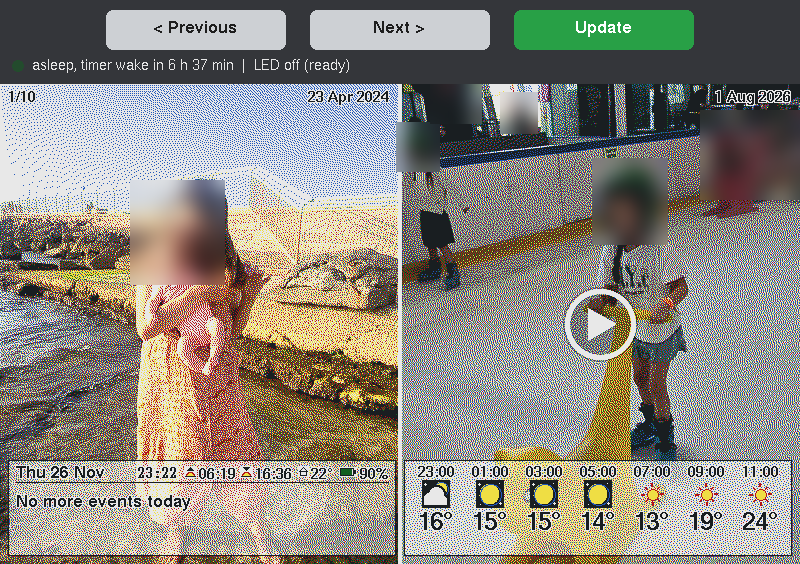

# frogterm

[](https://github.com/andrewpushkin/frogterm/actions/workflows/ci.yml)
[](LICENSE)


[](https://github.com/andrewpushkin/frogterm/releases/latest)

**Install it from the browser:** [andrewpushkin.github.io/frogterm](https://andrewpushkin.github.io/frogterm/)
(Chrome or Edge, USB cable), or download `firmware.bin` from the
[latest release](https://github.com/andrewpushkin/frogterm/releases/latest).

Firmware for a Seeed **reTerminal E1002** (ESP32-S3, 7.3" six-colour E Ink
Spectra 6 panel) that turns it into a family photo frame:

- a random photo from a **Google Photos** album (portrait photos come in pairs,
  one of them from the newest 300), with the date it was taken in its
  top-right corner,
- **today's events** from Google Calendar (tomorrow's once today is done),
- the **weather** now and in +2, +4 … +12 hours (rain chance, or the UV index when high;
  48 hours are fetched, so offline updates show their own next 12 hours),
- **room temperature** and **battery level**.

It updates three times a day (06:00, 13:30 and 18:15; `update_times`) and
whenever the green button is pressed, then
deep-sleeps (≈14 µA). Everything is written in Rust, and everything builds in
Docker.



*The PC emulator (`make emulator`): the reTerminal's buttons and LED on top, the
panel's six inks below — two portrait photos, today's events and the weather.
Faces blurred for this README.*

```
┌──────────────────────────────────────────────────────────────┐
│                       photo(s), full screen                  │
│┌──────────────────────────────┐┌────────────────────────────┐│
││Wed 25 Nov  Tel Aviv 06:00 ⌂22° ▭96%││06:00 07:00 ... 11:00  ││
││08:00-08:45  Математика       ││ ☀    ☀   ⛅   ☂            ││
││13:00-14:00  Swim             ││ 14°  16°  18°  19°         ││
││all day      Birthday         ││ UV 7      30%  60%         ││
│└──────────────────────────────┘└────────────────────────────┘│
└──────────────────────────────────────────────────────────────┘
```

## What you need

- Windows with WSL2, Docker with buildx (`docker-buildx`) inside WSL, `make`
- [usbipd-win](https://github.com/dorssel/usbipd-win) to give WSL the device's USB port
- a Google Photos album and (optionally) Google calendars — see below

Rust, the ESP32 toolchain, ESP-IDF and espflash are all in the Docker image,
which is built automatically the first time (`ubuntu:26.04`).

## Configure

```sh
cp config.example.toml config.toml
```

`config.toml` is gitignored and is the **only** place for private data on
the PC. The emulator reads it when it runs, and its **settings page** edits
it (see below). The device keeps its own copy of the same settings (in its
NVS flash) and edits it with the same page in its **settings mode** (see
"Using it"), so changing a setting needs no flashing. **`make flash` copies
`config.toml` into the device**: its first wake after flashing replaces the
device's settings with the file. Changes made on the device's page after
that stay until the next `make flash` — put them into `config.toml` too, or
flash with `NO_CONFIG=1` to keep the device's settings. `build/frogterm.bin`
(`make`) never contains your settings.

## Where to get your real data

### Photos: `album_url`

1. On [photos.google.com](https://photos.google.com): **Albums → New album**.
   For a frame that fills itself, choose **Automatically add photos of people
   & pets** and pick the faces (a "live album").
2. Open the album → **Share** (or **⋮ → Options**) → turn on **Link sharing**
   → **Copy link**. It looks like `https://photos.app.goo.gl/AbCdEf123`.
3. Anyone with this link can see the album. To revoke it, turn link sharing
   off and on again (new link) and put the new link in the settings page.

Check it on the PC: `make pc-check` reads the whole album without a login.

### Calendars: `calendars`

For **your own** calendars, use the *secret* iCal address:

1. On a computer, open [calendar.google.com](https://calendar.google.com) →
   ⚙️ **Settings**.
2. In the left column scroll down to **Settings for my calendars** and click
   the calendar.
3. Scroll to **Integrate calendar** → **Secret address in iCal format** → copy.
   It contains `/private-…/basic.ics` and works like a password.
   (The *public* address only works if the calendar is public.)

For **public** calendars (holidays), use the public address, e.g.
`https://calendar.google.com/calendar/ical/en.jewish%23holiday%40group.v.calendar.google.com/public/basic.ics`.

All calendars are merged. Repeating events, edited or cancelled occurrences
and all-day events are supported; a time written in the title ("13:00 Swim")
is removed because the time column shows it.

### Weather: `city`, `latitude`, `longitude`

Weather comes from [Open-Meteo](https://open-meteo.com) (free, no key).
`city` is looked up by name. For a specific neighbourhood, set `latitude` and
`longitude`: in Google Maps right-click the place — the first menu line is
`latitude, longitude`. `place_name` is the label shown on the screen.

### Time zone: `timezone`

A POSIX TZ string; the default is Israel, `IST-2IDT,M3.4.4/26,M10.5.0`
(UTC+2, summer time UTC+3 from the Friday before the last Sunday of March to
the last Sunday of October). The device sets its clock from the internet on
every Wi-Fi connection; this string only turns UTC into local time.

### Wi-Fi: `wifi_ssid`, `wifi_password`

Your 2.4 GHz network (the ESP32 has no 5 GHz). WPA2 or open.

### Other settings

`overlay_opacity`, `update_times`, `photo_batch`, `refresh_minutes` — see the
comments in `config.example.toml`.

## Try it on the PC first

```sh
make emulator     # the device in a window, with its three buttons to click
make emulator ARGS="--room 22 --battery 90 --seed 3"   # preview the header, fixed photos
make emulator ARGS=--no-rest       # no e-paper rest between refreshes
make emulator ARGS="--once next"   # no window: one wake (green|next|previous) -> out/screen.png, out/window.png
make emulator ARGS="--once hold-green"   # no window: the settings screen
make pc-check     # the Google album works without a login?
make tests        # all unit tests
```

The emulator runs the firmware's own wake logic (`core/src/app.rs`): click the
buttons on top — **< Previous**, **Next >** and **Update** (the green one),
in the device's order (or press Left / Right / Space) and it does exactly what the device does — stored
photos, batches, the panel's rest between refreshes, the scheduled timer wakes.
`out/` is its flash (stored screens, weather/calendar, state); delete it for
a factory-fresh device. The window shows the green LED (as on the device), a
countdown to the next timer wake and the last log line; a new image fades in
over 20 s, as long as the real panel takes; the full log is in the terminal.

**Buttons act when you let go**, as on the device. **Hold green 10 s** (mouse
or Space) for settings mode as the device's own Wi-Fi network, **hold right
10 s** for settings mode on this PC's network: the panel shows the network
and the page's address (`http://localhost:8080/`, the next free port if
taken). The page has every setting of `config.toml`; Save checks them and
rewrites the file, keeping its comments (the Wi-Fi password and secret
calendar links are never shown: left as they are, they stay). **Press green**
to finish: the emulator reads the file again and syncs. Nobody on the page
for 15 min also finishes. Without a usable `config.toml` (none yet, empty, or
wrong) the emulator starts in settings mode.

In WSL the window appears through WSLg. On Windows itself (no Docker), with
[Rust](https://rustup.rs) installed:

```powershell
cargo run --release -p frogterm-pc -- emulator
```

## Releases

Every push to `main` is a release: its number is the count of commits on
`main` (tag `v85` for the 85th). Each release has `firmware.bin` (an update:
upload it on the device's settings page, see "Firmware update"; the device
keeps its settings) and `firmware-full.bin` (a first install at `0x0`:
bootloader, partition table and app; it erases the settings). Neither
contains anyone's settings: a new device starts in settings mode. The same
push deploys the [GitHub Pages site](https://andrewpushkin.github.io/frogterm/)
(`site/`) with a browser installer for that release.

By hand with espflash (`erase-region` clears the record of an update
installed from the page, so the firmware just written is the one that runs):

```sh
espflash write-bin 0x0 firmware-full.bin && espflash erase-region 0xa10000 0x2000   # first install
espflash write-bin 0x10000 firmware.bin && espflash erase-region 0xa10000 0x2000    # update over USB
```

## Build and flash

One time, in an **administrator** PowerShell on Windows:

```powershell
winget install usbipd
usbipd list                      # find the reTerminal (USB serial), note its BUSID, e.g. 2-3
usbipd bind --busid 2-3
```

Then in WSL:

```sh
make                              # firmware -> build/frogterm.bin
make flash USBIPD_BUSID=2-3       # attaches the USB port to WSL and flashes, with config.toml
make flash NO_CONFIG=1            # flashes, the device keeps its own settings
make monitor                      # serial log (Ctrl+C to quit)
make flash FEATURES=bars          # test build: six colour bars only
```

### Testing over the serial port

The firmware takes button presses typed on its serial console (UART0, the
USB-C port): `green`, `next`, `previous` (`right`, `left`), `hold green`,
`hold next`, and `version`. While the device is awake a command acts as the
real button. In deep sleep the chip hears nothing, so the tool resets it
and types the command in the first 3 s after the start, where it counts as
the button that woke the device:

```sh
make press BUTTON=green             # reset, a green press, the log until it sleeps
make press BUTTON="hold green"      # settings mode (own Wi-Fi)
make send BUTTON=next               # a press now (the device is awake)
make log SECS=120                   # the log, no reset
```

To see an automatic update: flash a release number (`make flash FT_VERSION=98`
while release 98 is the newest), push one more commit to `main`, wait for its
release (`curl https://andrewpushkin.github.io/frogterm/version.txt`), then
`make press BUTTON=green`: the log shows "release 99 is out … installing",
the restart and "frogterm 99 woke by PowerOn".

`make flash` checks `config.toml` with the device's rules first (a wrong
value stops it). A device without settings (flashed with `NO_CONFIG=1`, or
its settings broken) starts in settings mode on its own Wi-Fi.

## Using it

Every button acts **when it is let go**. The one thing that happens while a
button is down: holding green or right for 10 s opens settings mode (below).

### Settings mode

- **Hold green 10 s**: the device makes its own open Wi-Fi network,
  **frogterm-setup**. Join it with a phone and open **http://192.168.4.1/**.
- **Hold right 10 s**: the device joins your Wi-Fi and serves the page there;
  the panel shows its address (e.g. `http://192.168.1.23/`). If it cannot
  join: three low beeps and nothing changes.
- The chirp comes at the 10-s mark, the LED stays on, and the panel shows the
  network and the address. The page has every setting; Save checks them
  (the device needs `wifi_ssid`) and stores them. The Wi-Fi password and
  secret calendar links are never shown: left as they are, they stay.
- **Press green** to finish: the device syncs with the new settings (after
  the panel's 3-minute rest). With settings that still cannot be used, green
  gets three low beeps and settings mode stays. Nobody on the page for
  15 min finishes too (an hour at most); with unusable settings the device
  then sleeps until a button is pressed.
- A device without settings starts in settings mode (own Wi-Fi) whenever a
  button wakes it.

### Firmware update

In settings mode the page also has a **Firmware** box: it shows the running
version; choose `firmware.bin` of a [release](https://github.com/andrewpushkin/frogterm/releases)
(download it before joining `frogterm-setup`, which has no internet) and
press **Install**. The device checks the file while it arrives (a whole
ESP32-S3 frogterm firmware, not `firmware-full.bin`), writes it next to the
running one, leaves settings mode and restarts with it at once; settings and stored photos
stay. If the new firmware crashes or hangs before its first normal sleep,
the device goes back to the previous one by itself at the next restart.

**Automatic updates** (`auto_update`, on by default; a checkbox on the page):
every sync also reads the release number on the [project site](https://andrewpushkin.github.io/frogterm/version.txt)
(one small request) and, when a newer release is out, downloads its
`firmware.bin` and installs it the same way, then restarts with it at once;
the new firmware does that sync itself (a full one). A release that was
rolled back is not installed again (the next one is). Only
a release updates itself: a firmware built and flashed locally (version
`dev`) never is replaced by one.

The device needs **one USB flash** of a firmware with this feature first
(it brings the flash layout with the update slots and the bootloader that
can roll back); until then the page says so. Flash layout: `factory`,
`photos`, `screens` as before, then `otadata`, `ota_0`, `ota_1` (3 MB each)
in the space that was free.

| Sound | Meaning |
|---|---|
| short high chirp | button press accepted |
| three short high pips | busy: the press is ignored (press again when the LED is off) |
| one beep | ready again after a good update (when the panel's 3-minute rest ends) |
| three low beeps | ready again after a failed update (retried in 30 min, up to 3 times) |

| LED | Meaning |
|---|---|
| on | busy: working (Wi-Fi sync, downloads, drawing) or the panel rests after a refresh (3 min); presses are ignored |
| off | ready: a press is done right away |

- **Green button**: always syncs over Wi-Fi: downloads a new batch of
  photos, the weather and today's and tomorrow's events, and shows the first
  new photo. The LED is on from the moment the device wakes until it is
  ready again; the panel rests 3 minutes between refreshes (E Ink care). A
  press while the LED is on gets three short pips and is ignored. The final
  beep comes when the LED goes off.
- **Scheduled updates**: a stored photo not seen yet; once every stored photo
  has been on the screen, a new batch is downloaded.
- **Side buttons**: previous / next stored photo, no Wi-Fi. Photos seen this
  way count as seen.
- **No Wi-Fi most of the time**: the device keeps a batch of 10 ready-to-show
  photos in flash. A scheduled wake within 8 h of the last weather/calendar fetch (same
  day) shows a stored photo without Wi-Fi (~1.6 s awake). Older data is
  fetched again; when all stored photos were seen, a new batch is downloaded.
- **Battery**: a refresh is skipped below 3.45 V (no half-drawn screens).
- **Failed sync**: if a sync fails for any reason (no Wi-Fi, or the weather, a
  calendar or photos did not come), the screen shows a red-struck Wi-Fi icon
  left of the time, with the last stored photo, weather and events. It stays
  until a sync gets everything; a failed update retries in 30 min (3 times).

## How it works

- `core/` — everything testable on a PC that also runs on the ESP32: Google
  album reading, dithering to the six inks, layout and fonts (event titles in
  Rubik SemiBold — Latin, Cyrillic and Hebrew right-to-left — rasterized to 1 bit
  at build time by `core/build.rs`), weather, iCal calendar, Israel time zone, schedule,
  panel protocol, what one wake does (`app.rs`, behind a `Device` trait), the
  settings file (`config.rs`), the settings page (`portal.rs` + `portal.html`)
  and press/hold detection (`buttons.rs`).
- `pc/` — the emulator (a PC `Device` in a window) and the album check.
- `firmware/` — the reTerminal `Device`, with `esp-idf-svc`: e-paper on
  SPI, RTC and temperature sensor on I2C, buzzer, battery, Wi-Fi, HTTPS,
  flash storage, deep sleep, and settings mode (`portal.rs`: access point or
  home Wi-Fi, the page on port 80, the settings in NVS).
- `docs/superpowers/` — design and implementation plan.

Flash wear: photo slots are rewritten about once per batch, the weather and
calendar (and the settings, when saved) go to wear-levelled NVS, the album list weekly — far below the
~100 000 erase cycles of the flash.

## Credits

- ED2208 panel init sequence: Zephyr `drivers/display/display_ed2208_gca.c`
  (Apache-2.0), matching Seeed_GFX.
- Battery voltage-to-percent table: Seeed's reTerminal E-series ESPHome cookbook.
- Font: [Rubik](https://github.com/googlefonts/rubik) (SIL Open Font License,
  `core/fonts/OFL.txt`).

## License

MIT — see [LICENSE](LICENSE).
